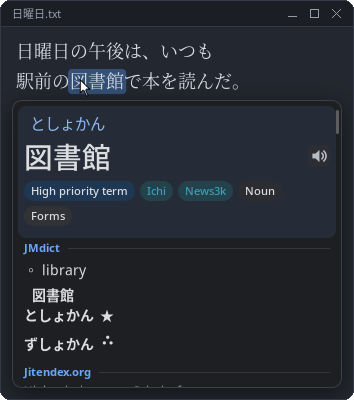
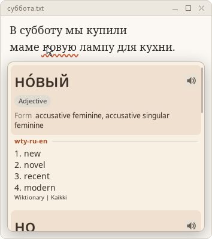
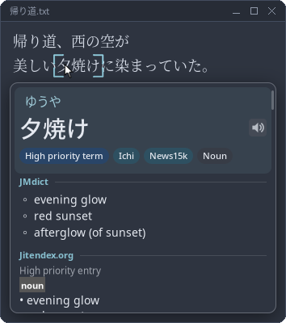

# Lexiglance

[](https://github.com/MattFor/lexiglance/actions/workflows/ci.yml)
[](https://github.com/MattFor/lexiglance/releases/latest)
[](LICENSE)
[](https://appimage.github.io/Lexiglance/)

System-wide pop-up dictionary for Linux (X11), Windows and macOS.

<p>
  
  
  
</p>

**[Download for Windows](https://github.com/MattFor/lexiglance/releases/latest/download/lexiglance-windows-setup.exe)**
· **[Download for Linux](https://github.com/MattFor/lexiglance/releases/latest/download/Lexiglance-x86_64.AppImage)**
· **[Download for macOS](https://github.com/MattFor/lexiglance/releases/latest/download/Lexiglance-macos.dmg)**
· [Other packages](https://github.com/MattFor/lexiglance/releases/latest)

## Features

Ever tried learning a language and gotten frustrated because pop-up dictionaries only work inside your browser? Worry no
more!

Hold a key combination and point at a word in any application to see its definitions. It supports Japanese, Russian,
Ukrainian, Korean and Greek, and uses the same dictionary format as [Yomitan](https://yomitan.wiki/).

- Reads text through the accessibility interfaces (AT-SPI, UI Automation, macOS Accessibility), or with OCR (PaddleOCR,
  Tesseract) in games, images and videos.
- Dictionaries are compiled into memory-mapped indexes.
- Deinflection: 食べさせられなかった finds 食べる, книгами finds книга.
- Whole sentences translated into English, on your computer: hold the sentence key with the trigger, or select the
  text. The translation models ([OPUS-MT](https://github.com/Helsinki-NLP/Opus-MT), about 115 MB a language, or
  440 MB in full precision, which translates about twice as fast - each language uses whichever you pick) run offline,
  so nothing you read is sent anywhere.
- Recommended dictionaries for each language can be installed from the settings application.
- Pronunciation audio, and Anki cards through AnkiConnect.
- Configurable popup designs, colour schemes and highlight styles ([docs/themes.md](docs/themes.md)).
- A health check that diagnoses common setup problems, with a quick fix button.
- Statistics: what you have looked up, in which languages and on which days, kept on your computer only.
- No input injection and no access to other processes, it won't trigger any anti-cheats - feel free to use it in games!
  ([details](docs/anticheat.md)).

## Install

- **Windows 10 (1809 or later) and 11:** download
  [lexiglance-windows-setup.exe](https://github.com/MattFor/lexiglance/releases/latest/download/lexiglance-windows-setup.exe)
  and run it. Administrator permissions are not needed, it may also warn about an unknown publisher: choose **More
  info -> Run anyway**. Running a newer one updates in place. For games that run as administrator, turn on
  **Overview -> Run as administrator**. Untick **Install the settings window** (`/NOGUI` with `/S`) for the daemon and
  `lexiglancectl` alone: set up through `config.json` (edits take effect within two seconds), and updated by running a
  newer setup.
- **Linux:** download
  [Lexiglance-x86_64.AppImage](https://github.com/MattFor/lexiglance/releases/latest/download/Lexiglance-x86_64.AppImage),
  make it executable (`chmod +x Lexiglance-x86_64.AppImage`) and run it.
- **macOS 13.3 Ventura or later (Apple silicon and Intel):** download
  [Lexiglance-macos.dmg](https://github.com/MattFor/lexiglance/releases/latest/download/Lexiglance-macos.dmg), open it
  and drag Lexiglance onto Applications. It is not notarised by Apple, so the first time macOS will not open it: open it
  once, then choose **Open Anyway** in **System Settings -> Privacy & Security**. Allow Lexiglance there under
  Accessibility, Input Monitoring and Screen Recording (for OCR) when it asks. After an update macOS may ask for them
  again.

The [releases page](https://github.com/MattFor/lexiglance/releases) also has a portable `.zip` for Windows, a `.deb`
for Debian and Ubuntu, a `.rpm` for Fedora, and a `.tar.gz`. From then on Lexiglance keeps itself up to date
(**Overview -> Updates**), in the background too while you are away from the computer.

## Usage

1. Open **Dictionaries -> Get recommended dictionaries**, pick a language and install.
2. Hold **Super + Left Alt** (on Windows **Win + Left Alt**, on macOS **Command + Left Option**) and point at a word.
3. Keep holding the keys and use the scroll wheel to select more characters (or fewer). The popup goes when you let go;
   to use it, move onto it first. Left-click an entry to copy it, or right-click and select text within it instead.
4. Hold **Left Shift** as well to see the sentence in English, or only the characters you selected. The **Translation**
   page downloads the models (compact or full precision, per language) and sets the key.

For games, videos and other programs that expose no text, click **Scanning -> Download PaddleOCR** once. On Linux,
Chromium and Electron apps need `--force-renderer-accessibility`.

The tray icon (the menu bar icon on macOS) pauses scanning, turns it off in the program you looked something up in
last, and lists your recent lookups. **Search** looks up what you type or copy, and plays, copies or sends each entry
to Anki. Drop dictionary zips anywhere on the settings window to import them, and take your settings to another
computer with **Overview -> Settings -> Export**.

Something wrong? **Overview -> Health -> Report a problem** saves a report on your computer (nothing is sent) and opens
a GitHub issue filled in for you to attach it to. See [docs/debugging.md](docs/debugging.md).

### Languages

Each language is a small JSON file, and you can add your own without rebuilding. See
[docs/languages.md](docs/languages.md).

## Building

You need CMake 3.30+, GCC 14 or Clang 18+, zlib, Cairo, Pango, libcurl and Qt 6.4+. On Linux also Xlib (with XInput2,
XFixes, XRandR, Xext) and AT-SPI 2. On macOS, Xcode's command line tools.

```sh
cmake --preset release
cmake --build --preset release
ctest --preset release
```

Then run `build/release/apps/gui/lexiglance`. For Windows and macOS builds see [docs/porting.md](docs/porting.md).

## Contributing

See [CONTRIBUTING.md](CONTRIBUTING.md). Please report security problems privately through
[GitHub security advisories](https://github.com/MattFor/lexiglance/security/advisories/new).

## Disclosure

Yes, this one was mostly written with the help of an LLM. I wanted to get the program up and running as quickly as
possible so that my friends and I could start using it in our language-learning journeys. Writing everything by hand
would have taken a very, very long time!

Of course, I still review the code and documentation myself. I don't want to get completely lost in the madness

I hope Lexiglance can be a useful tool to others and help everyone on their own language-learning journey!

## License

MIT, see [LICENSE](LICENSE). By [MattFor](https://github.com/MattFor).

Dictionaries, OCR and translation models and recordings are downloaded separately and keep their own
licences. Lexiglance includes the ONNX Runtime headers (MIT), a kanji table
from [OpenCC](https://github.com/BYVoid/OpenCC) (Apache 2.0) and
[Breeze](https://invent.kde.org/frameworks/breeze-icons) icons (LGPL 3.0).
